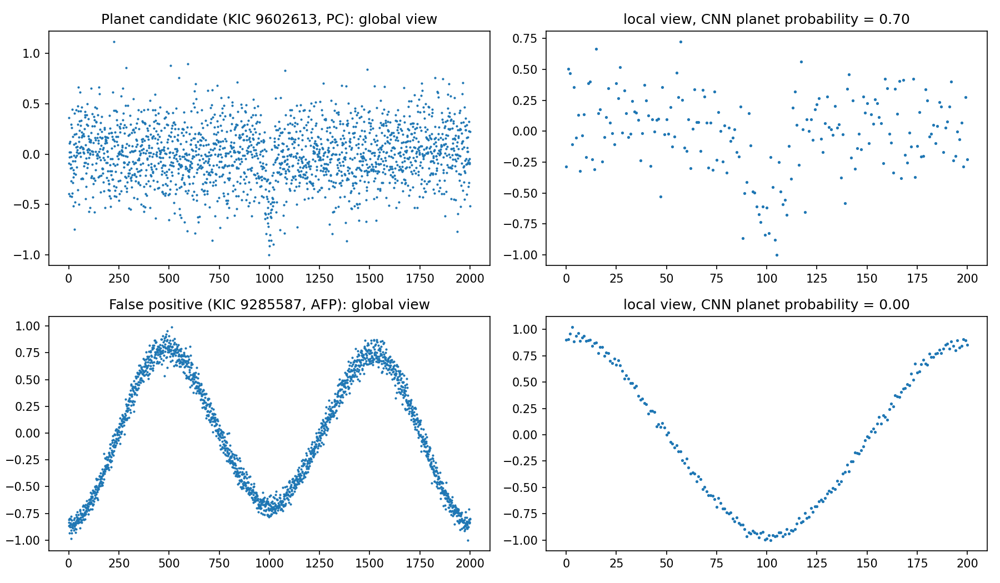

# Exoplanet Finder

A two-view 1D CNN that reads folded NASA Kepler light curves and estimates whether a repeating dip in a star's brightness is a planet or a false positive. It is compared against a gradient-boosting baseline that only knows the dip's period, duration and depth.

*Folded Kepler light curves from stars never seen in training. Top: a planet candidate, a shallow dip in a flat baseline (CNN planet probability 0.70). Bottom: an astrophysical false positive with a smooth, continuous brightness variation (probability 0.00).*

## Results

Evaluated on 185 held-out signals (56 planet candidates) from stars never seen in training.

| Model | AUC | Precision | Recall |
|---|---|---|---|
| Baseline (period, duration, depth; gradient boosting) | 0.906 | 0.750 | 0.696 |
| Two-view 1D CNN | 0.906 | 0.709 | 0.696 |

**Summary:** on this amount of data the CNN matched the baseline. The difference in AUC (0.0004) is far smaller than the noise of a 185-example test set, so I do not claim either model is better.

An earlier pilot on 45 test examples showed the CNN ahead (0.976 vs 0.936 AUC). The larger test set shows that gap was chance, which is why the pilot numbers are not used as the result.

## How it works

1. Load the Kepler Q1-Q17 DR24 TCE table from the NASA Exoplanet Archive. Keep signals labeled PC (planet candidate), AFP (astrophysical false positive) or NTP (non-transiting phenomenon). PC counts as "planet", the rest as "not planet".
2. Split by star, so no star appears in more than one of train, validation and test.
3. Download each star's long-cadence light curve from NASA's MAST archive with `lightkurve`, stitch the quarters together and remove missing values.
4. Mask the transits, flatten the slow brightness drift, and fold on the signal's period.
5. Bin into two views: a global view (2,001 bins, whole orbit) and a local view (201 bins, 4 transit durations on each side). Normalize each so the median is 0 and the deepest point is -1.
6. Train a two-branch 1D CNN (one branch per view) with binary cross-entropy. Early stopping uses the validation set.
7. Score once on the test set.

## Data used

| Split | Examples | Planets |
|---|---|---|
| Train | 1,226 | 260 |
| Validation | 158 | 20 |
| Test | 185 | 56 |

These come from a random sample of 1,000 stars out of the full table.

## How to run

Open the notebook in Google Colab and run the cells in order. Light curves are cached to Google Drive after the first download, so re-runs do not re-download them. Random seeds are fixed (42) for the split and the model.

## Limitations

- **Small training set.** 1,226 training examples, versus about 15,000 in the published Kepler CNN work this project follows. CNNs usually need much more data before shape information helps, which is the most likely reason for the tie.
- **Small test set.** 185 examples with 56 planets, so all scores carry wide uncertainty. No confidence intervals were computed.
- **Small validation set.** Only 20 validation planets, so early stopping was based on a noisy signal.
- **Labels are imperfect.** The Autovetter labels contain errors, including eclipsing binaries labeled as planet candidates, so some "mistakes" may be label errors. The AFP class also includes more than eclipsing binaries, so I do not call the example false positive an eclipsing binary.
- **Kepler only.** The model was trained on Kepler long-cadence data and has not been tested on other missions.
- **Test set seen once.** The test set was scored one time after training. No settings were tuned on it.
- **Simplified model.** The network is smaller than the published one and was not tuned.
- **Threshold.** Precision and recall use a fixed 0.5 probability cutoff, which was not optimized.

## Data sources

- Kepler Q1-Q17 DR24 TCE table: NASA Exoplanet Archive
- Light curves: NASA MAST archive, via `lightkurve`
- Approach follows Shallue and Vanderburg (2018), the paper that found Kepler-90i
